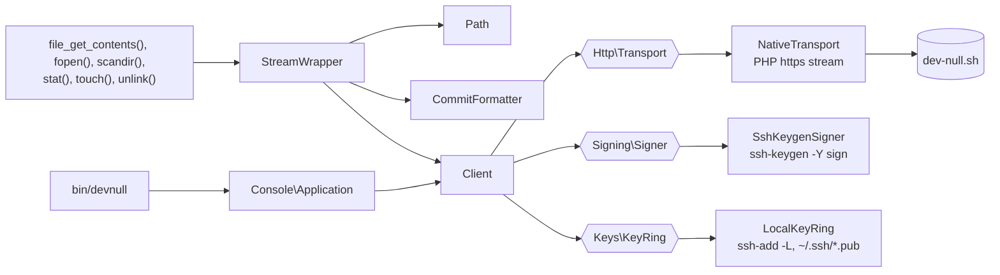

# devnull-stream

A `devnull://` PHP stream wrapper for [dev-null.sh](https://dev-null.sh): read, commit, reply, star, give pastéis and
delete with PHP's plain file functions.

```php
echo file_get_contents('devnull://@dseguy');                  // their commits, `git log` style
file_put_contents('devnull://@me', 'Hello from PHP!');        // a commit, signed with your SSH key
touch('devnull://@dseguy/commits/<id>/star');                 // a star
```

It has no dependency beyond PHP itself: requests go through PHP's native `https://` stream and signatures through
`ssh-keygen`.

## Requirements

- PHP 8.5 or later, with `allow_url_fopen` enabled
- `ssh-keygen` from OpenSSH 8.2 or later, to write (reading needs nothing more)

## Installation

```shell
composer require jubianchi/devnull-stream
```

The `devnull://` wrapper is registered as soon as Composer's autoloader is loaded. Without Composer's autoloader, call
`Jubianchi\DevNull\StreamWrapper::register()` yourself; registering twice is harmless.

## Usage

### Paths

| Path                                   | Read          | Write          | `touch()`        | `unlink()` |
|----------------------------------------|---------------|----------------|------------------|------------|
| `devnull://@user`                      | their commits | commits as you |                  |            |
| `devnull://@user/replies`              | their replies |                |                  |            |
| `devnull://@user/commits/<id>`         | one commit    | replies to it  |                  | deletes it |
| `devnull://@user/commits/<id>/star`    |               |                | stars it         | unstars it |
| `devnull://@user/commits/<id>/pasteis` |               |                | gives it pastéis |            |

`devnull://@user` and `devnull://@user/replies` are directories of commit ids; commits are files.

### Read

```php
echo file_get_contents('devnull://@dseguy');                  // their commits
echo file_get_contents('devnull://@dseguy/replies');          // their replies
echo file_get_contents('devnull://@dseguy/commits/<id>');     // one commit

print_r(scandir('devnull://@dseguy'));                        // their commit ids
var_dump(file_exists('devnull://@dseguy/commits/<id>'));
echo date('c', filemtime('devnull://@dseguy/commits/<id>'));
```

Commits read like `git log`:

```text
commit 01a16807-1328-7241-b932-f19dd0286c13
Author: Seguy Damien <@dseguy>
Date:   2026-10-23T09:10:56Z
Stars:  3  Replies: 1

    After witnessing the frenzy around #PHP deploying its most recent fix…
```

Lists are paginated by the API: the next page is only fetched when the reader gets to it, so
`fgets(fopen('devnull://@dseguy', 'r'))` costs a single request.

### Commit and reply

Writes are signed with an SSH key of your GitHub account, as `curl -fsSL dev-null.sh/commit | bash` does: no
sign-up and no token.

```php
use Jubianchi\DevNull\StreamWrapper;

file_put_contents('devnull://@me', 'Hello from PHP!');                     // commit
file_put_contents('devnull://@dseguy/commits/<id>', "Let's do it!");       // reply

echo StreamWrapper::$lastResponse;                                         // link to what was created
```

The message is sent once, when the stream closes, so several `fwrite()` calls make a single commit:

```php
$commit = fopen('devnull://@me', 'w');
fwrite($commit, "Shipped!\n\n");
fwrite($commit, 'devnull:// is out.');
fclose($commit);
```

`StreamWrapper::$lastResponse` is read-only outside the wrapper and holds `''` when the last write failed.

### Star, give pastéis and delete

These go through the signed API the mobile app uses, with a key approved as a device of your account (see
[Authorize a key](#authorize-a-key)).

```php
touch('devnull://@dseguy/commits/<id>/star');       // star
unlink('devnull://@dseguy/commits/<id>/star');      // unstar
touch('devnull://@dseguy/commits/<id>/pasteis');    // give a pastel de nata
unlink('devnull://@me/commits/<id>');               // delete one of your commits
```

### Errors

The wrapper never throws: like any stream, it raises a warning saying what went wrong and the file function returns
`false`.

```text
Warning: devnull: POST /api/v1/commits/<id>/star failed (HTTP 401): This key isn't approved for the /dev/null app. Sign in again in the app.
Warning: Write to devnull://@you to commit, or to devnull://@user/commits/<id> to reply, not to devnull://@me/replies.
```

### Settings

| Environment variable | Context option | Default                                                       |
|----------------------|----------------|---------------------------------------------------------------|
| `DEVNULL_URL`        | `url`          | `https://dev-null.sh`; only `https://` or local `http://` URLs |
| `DEVNULL_KEY`        | `key`          | see [Which key signs](#which-key-signs)                       |

Context options win over the environment:

```php
$context = stream_context_create(['devnull' => ['key' => getenv('HOME').'/.ssh/id_devnull']]);

file_put_contents('devnull://@me', 'Signed with another key', 0, $context);
```

## Authorize a key

Stars, pastéis and deletion need a key approved as a device, once:

```shell
vendor/bin/devnull authorize "My laptop"
```

1. The command prints a `https://dev-null.sh/mobile/authorize?…` link: open it, sign in and approve.
2. The page then sends your browser to a `devnull://authorize?code=…` link, which it cannot open. Copy that link
   from the address bar, or from the `Location` header of the approval's `POST` in the developer tools' Network
   tab, and paste it in the terminal.

The command redeems the code with a [PKCE](https://www.rfc-editor.org/rfc/rfc7636) verifier only it knows, so the
link is useless to anyone else, and prints the account the key was approved for.

## How signing works

Private keys are never read: `ssh-keygen -Y sign` signs, from your key file or through your SSH agent, and the wrapper
only reads public keys.

| What                  | Endpoint                 | Namespace        | Signed message                                     |
|-----------------------|--------------------------|------------------|----------------------------------------------------|
| Commit, reply         | `POST /api/cli/commits`  | `devnull-commit` | `<timestamp>\n<nonce>\n<reply to or empty>\n<body>` |
| Star, pastéis, delete | the `/api/v1` signed API | `devnull-api`    | `<timestamp>\n<nonce>\n<METHOD>\n<path and query>\n<JSON body>` |

The nonce is 32 random hexadecimal characters. The signature goes in the `X-SSH-Signature` header, as the bare base64
of the armored signature; the signed API also gets `X-Devnull-Timestamp` and `X-Devnull-Nonce`.

### Which key signs

- `DEVNULL_KEY` (or the `key` context option) when set: a private key file, or a public key held by your SSH agent.
- Otherwise, to commit: the first Ed25519 or RSA key of your SSH agent or of `~/.ssh/*.pub` that dev-null.sh finds on
  the GitHub account of one of its users (`POST /api/cli/key-lookups`, with public keys only).
- Otherwise, for the signed API: the first of those keys, since devices know nothing of GitHub.

## Design

The stream wrapper is a thin adapter over a client, whose transport, signer and key discovery are ports, so that
everything is tested without network.



`StreamWrapper::useClientFactory()` replaces how the wrapper builds its client, e.g. to plug another transport.

## Development

```shell
composer install
composer test       # Pest; the signing tests use the real ssh-keygen and skip without it
composer analyse    # PHPStan, max level
composer lint       # Pint, dry run (composer fix applies it)
```

## License

[MIT](LICENSE)
